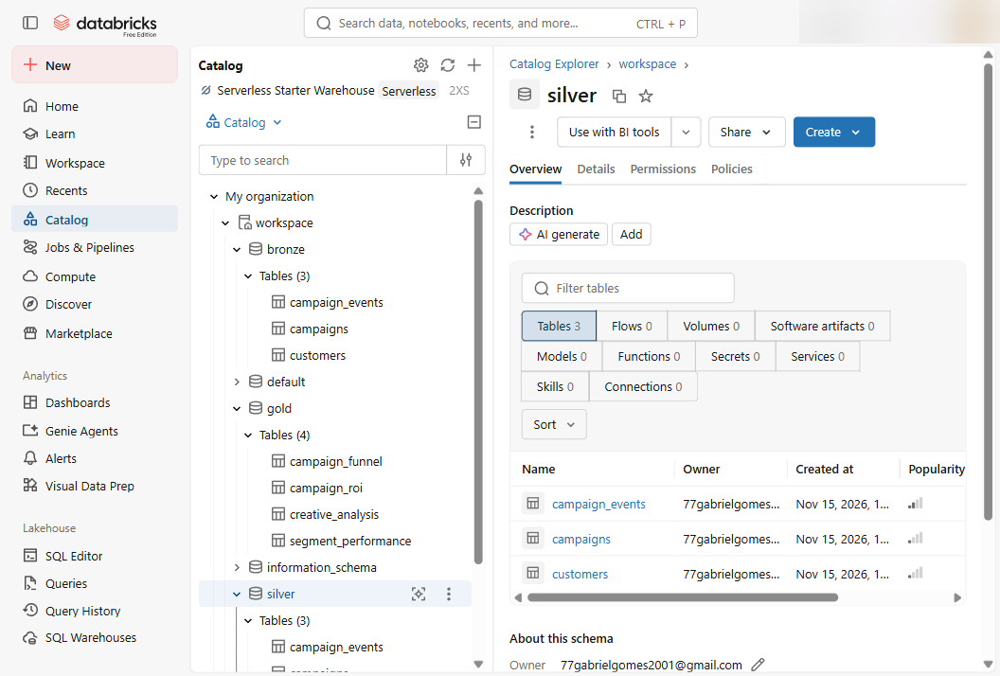
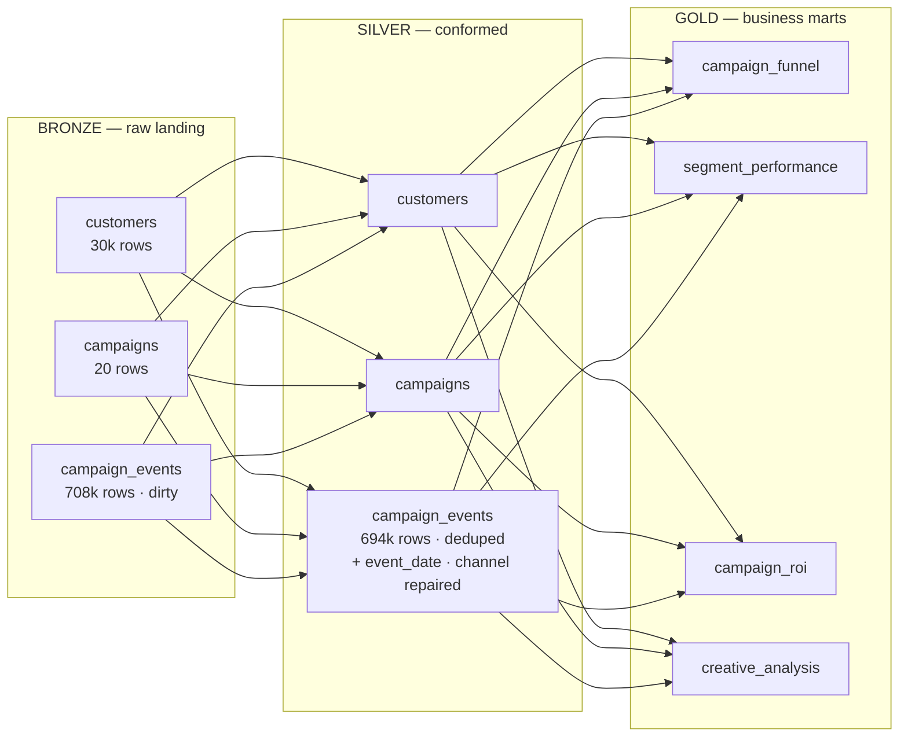
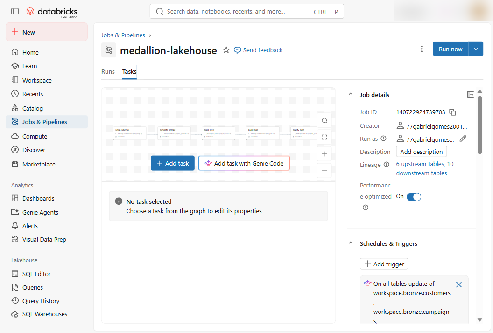
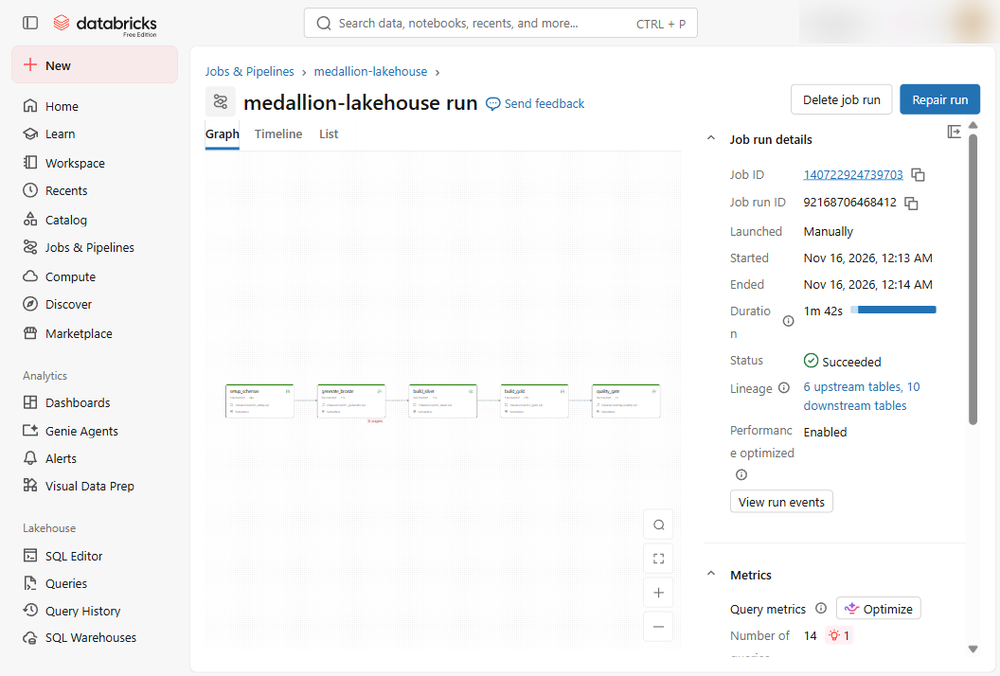
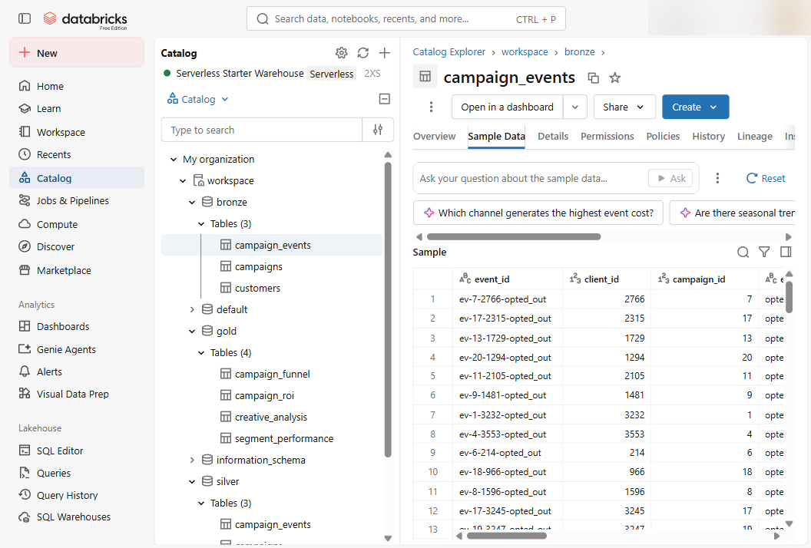
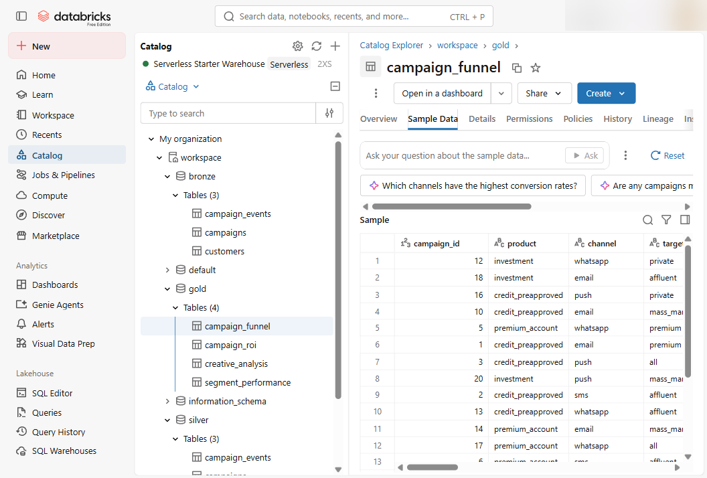
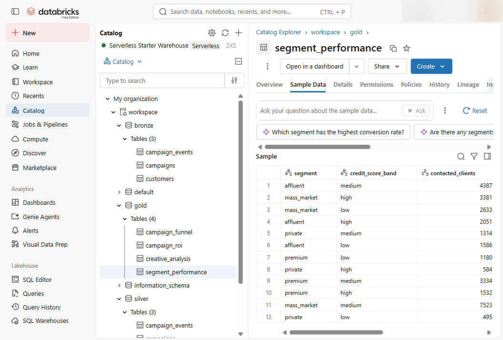
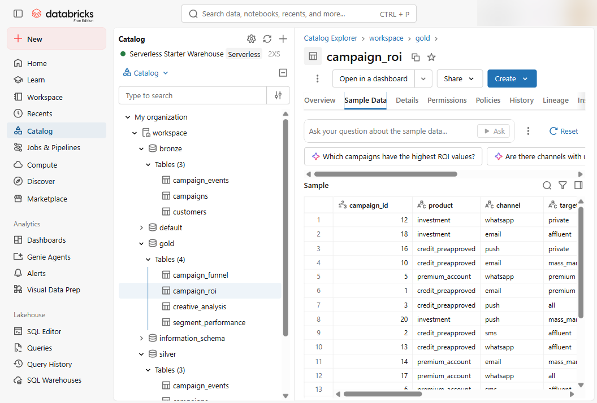
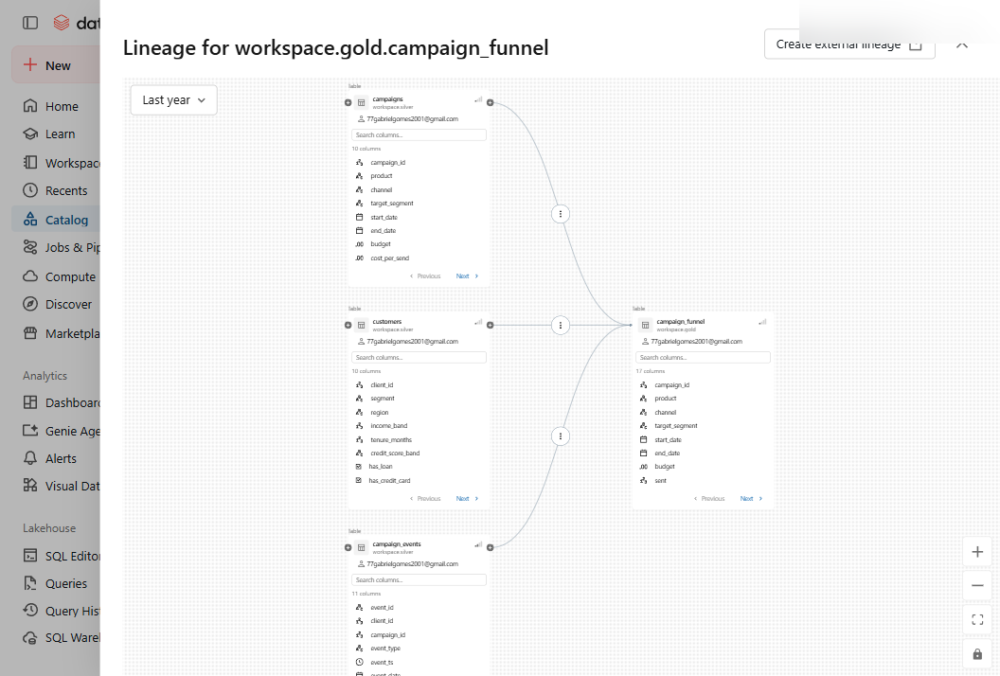

# Bank Medallion Lakehouse

A medallion-architecture data lakehouse on **Databricks**, built SQL-only over a
synthetic digital-bank campaign dataset: 30,000 customers, 20 campaigns and
~700k engagement events flowing through bronze → silver → gold, orchestrated
by a Databricks Job, governed by Unity Catalog, and gated by SQL data-quality
assertions.



---

## Why this project

Most "Databricks hello-world" repos stop at `spark.read.csv()` → one table.
This one is built like a real analytics platform slice:

- **A real ingestion problem** — the bronze layer is deliberately *dirty*
  (exact duplicates, NULL channels, NULL creatives, skewed funnel stages) so
  the silver layer has actual work to do.
- **Business-shaped gold** — four marts that answer marketing questions
  (funnel conversion, segment performance, campaign ROI, creative analysis),
  not just transformed copies of bronze.
- **An enforced contract** — seven `raise_error()` assertions that fail the
  pipeline loudly when data violates the layer's promises.
- **Observable by construction** — every run is a Job with task-level history,
  every table carries Delta version history and Unity Catalog lineage.

## Architecture



The pipeline is five sequential tasks in a Databricks Job:

```
setup_schemas → generate_bronze → build_silver → build_gold → quality_gate
```





Total wall time: **under 2 minutes**, fully serverless — no cluster to
provision, no infrastructure to manage.

## The data

The dataset is **synthetic and generated inside the pipeline itself** — no CSV
uploads, the repo is self-contained. Generation is deterministic: every
random draw is `pmod(xxhash64(<key>), N) / N`, so re-running produces
byte-identical data on any workspace.

What makes it analytically interesting rather than random noise:

- Each customer carries a latent **`propensity`** score computed from
  income band, tenure, credit-score band and segment. Funnel stage
  probabilities are driven by it — so gold analytics surface *real*
  segment effects instead of uniform randomness.
- Campaigns carry a **`target_segment`** and a **`conversion_value`**,
  enabling targeting-accuracy and ROI analysis.
- The funnel is **hierarchical**: a customer can only convert if they
  clicked, only click if they opened — matching how real engagement
  funnels behave.

### Deliberate data-quality problems (the mess)

| Problem | Rate | Where it's fixed |
|---|---|---|
| Exact duplicate event rows | ~2% | silver: `row_number()` dedup on `event_id` |
| NULL `channel` | ~1% | silver: `COALESCE` back to the campaign's channel |
| NULL `creative_variant` / text | ~3% | tolerated — creative mart groups them as unknown |
| Funnel stage skipping | prevented by design | nested stage flags in the generator |




Bronze holds **708,131** event rows; silver ends at **694,138** — the ~2%
delta is exactly the duplicate mass the pipeline removes.

## The layers

**Bronze** mirrors the source shape — three tables (`customers`, `campaigns`,
`campaign_events`) exactly as a landing zone would receive them, warts and
all.

**Silver** is the conformance layer: deduplication, type/date derivation
(`event_date` from `event_ts`), NULL-channel recovery via the campaign
dimension, and explicit column contracts. This is where "analytics can
trust the data" becomes true.

**Gold** is four denormalized marts, each answering a business question:

| Mart | Question it answers |
|---|---|
| `campaign_funnel` | How does each campaign convert stage-by-stage — and did it reach the segment it *targeted*? (`target_contact_share` vs `target_conversion_share`) |
| `segment_performance` | Which customer segments convert, and does the latent propensity signal show through? |
| `campaign_roi` | Cost vs conversions vs revenue per campaign — `roi` and `roas` |
| `creative_analysis` | Which creative variant opens/clicks/converts, with text-length features |







## Data quality gate

`04_quality.sql` encodes the contract each layer promises as executable
assertions — `raise_error()` fails the job loudly on violation:

- bronze volume inside expected bounds (~400k–900k events)
- the mess *exists* in bronze (NULL channels present) **and** is *gone* in
  silver — proving the cleaning actually ran
- zero duplicate `event_id` after silver dedup
- funnel monotonicity per campaign (`converted ≤ clicked ≤ opened ≤ …`)
- referential integrity (no orphan events)
- ROI sanity (no non-positive costs)


## Platform capabilities exercised

- **Unity Catalog** — `workspace.bronze/silver/gold` schemas; table-level
  governance, permissions and automatic lineage.
- **Delta Lake** — every table is a Delta table: ACID writes, and full
  version history for time travel.


- **Lineage** — Unity Catalog tracks table-level dependencies across the
  medallion flow automatically.



- **Databricks Jobs** — the orchestration DAG above, run history, per-task
  durations, serverless compute.
- **SQL warehouses** — all transformations are pure SQL (CTAS + CTEs +
  window functions); no PySpark anywhere in the pipeline.

## Results worth noting

The synthetic ground truth produces analytically honest signals:

- **Propensity shows through**: `private`/`high` credit customers convert at
  ~15% end-to-end vs ~5% for `mass_market`/`low` — and `avg_propensity`
  correlates directly with `conversion_rate` in the segment mart.
- **Channel economics are visible**: `push` campaigns (near-zero send cost)
  post ROI in the hundreds, while `whatsapp` (R$0.30/send) lands under 100 —
  the classic reach-vs-cost trade-off, now queryable.
- **Targeting has measurable accuracy**: campaigns aimed at `premium`
  convert that segment at a higher share than their contact share;
  mis-aimed campaigns show the gap explicitly.

## Repository layout

```
├── sql/
│   ├── 00_setup.sql        # schemas (bronze/silver/gold)
│   ├── 01_generate.sql     # deterministic synthetic generator → bronze
│   ├── 02_silver.sql       # dedup, conformance, channel repair
│   ├── 03_gold.sql         # four business marts
│   └── 04_quality.sql      # seven fail-loud data-quality assertions
├── jobs/
│   └── medallion-lakehouse-job.yml   # the 5-task orchestration DAG
├── tools/
│   └── run_sql.py          # stdlib runner (SQL Statement Execution API)
└── docs/screenshots/       # evidence captured from the live workspace
```

## Reproduce it

1. Create a [Databricks Free Edition](https://community.cloud.databricks.com/)
   workspace (Unity Catalog included, serverless SQL warehouse provisioned).
2. Import `sql/*.sql` as SQL notebooks (Workspace → Import, or
   `workspace/import` API with `language=SQL`).
3. Either run the Job (`jobs/medallion-lakehouse-job.yml` — adjust
   `notebook_path`) or execute the files in order; `tools/run_sql.py` runs
   them via the Statement Execution API:

   ```bash
   cp .env.example .env   # DATABRICKS_HOST + DATABRICKS_TOKEN
   python tools/run_sql.py sql/
   ```

4. Browse `workspace.bronze|silver|gold` in Catalog Explorer.

## Production evolution (designed, not built here)

This POC proves the medallion mechanics on platform-managed compute. A
production version would change the *edges*, not the core:

- **Ingestion**: S3/ADLS landing zone + Auto Loader (or Lakeflow pipelines /
  DLT) instead of the in-SQL generator.
- **Orchestration**: Databricks Asset Bundles (the `jobs/*.yml` already points
  that way) or Terraform for the AWS-side resources (EventBridge, Lambda).
- **AI enrichment**: `ai_query()` over `gold.creative_analysis` to generate
  segment/creative narratives — the query is designed and documented, but
  Databricks Free Edition does not expose `system.ai` model services, so it
  is intentionally out of scope here (verified: model endpoints return
  "does not exist or is not accessible" on this workspace tier).

## Notes

- All data is synthetic by design — the generator, distributions and
  quality problems are documented in `sql/01_generate.sql` so the dataset is
  reproducible and auditable rather than mocked.
- Costs: `conversion_value` is an assumed revenue proxy per conversion, used
  to make ROI arithmetic concrete — it is a modeling choice, not a claim
  about real banking products.
- GitHub's language bar can't represent this repo: Linguist classifies
  `.sql` files as `data`, so the SQL (which *is* the project) never shows
  up and the bar would read "100% Python" for a small helper script in
  `tools/`. Python is marked non-detectable in `.gitattributes` instead.
